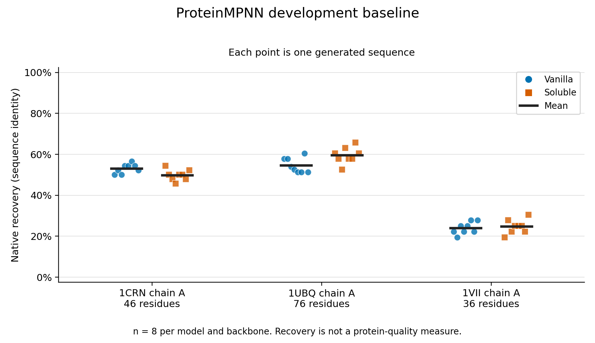
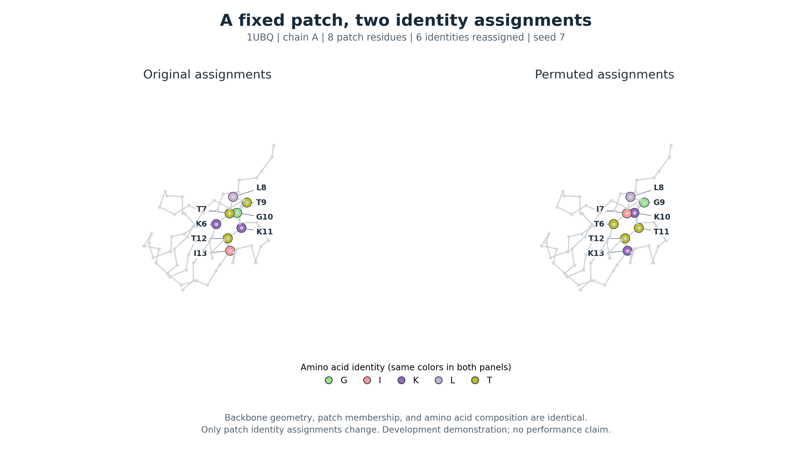

# Ashwath's mid-report contribution: baseline and reproducible patch example

Draft based on completed November 4, 2026 runs. This covers the implemented baseline and handoff; Kirti's controlled patch experiment and the team's background/evaluation sections must be assembled separately. All numbers come from the [pilot table](../../Analysis/baseline_pilot/summary.csv), [run record](../../Analysis/baseline_pilot/run_record.json), and [handoff checks](../../Analysis/handoff_20261104/handoff_checks.json).

## Methods: frozen-model development baseline

We established a reproducible frozen ProteinMPNN pipeline before introducing a patch-level objective. We used the official vanilla and soluble `v_48_020` checkpoints from ProteinMPNN commit `8907e6671bfbfc92303b5f79c4b5e6ce47cdef57`, verifying SHA256 hashes for model code, checkpoints and structural inputs. The development inputs were chain A of ubiquitin ([1UBQ](https://www.rcsb.org/structure/1UBQ), 76 residues), villin headpiece ([1VII](https://www.rcsb.org/structure/1VII), 36 deposited residues numbered 41–76), and crambin ([1CRN](https://www.rcsb.org/structure/1CRN), 46 residues). These small convenience inputs exercise the pipeline; they are not a representative benchmark or independent test set. We retained complete canonical N, CA, C and O backbone coordinates for the selected chain, preserved residue identifiers, and checked the resulting sequence and coordinates against ProteinMPNN's parser. Side chains, waters and other heteroatoms were excluded. All three inputs passed these checks.

For each structure/checkpoint combination, we sampled eight full-chain sequences at temperature 0.1, batch size 1, seed 37 and zero added backbone noise, for 48 generated sequences in total. The same explicit seed was supplied to each subprocess; no model parameters were trained. We retained sequences, native references, generation-run negative log-probability scores, commands, environment metadata and timings. Validation required the expected count and length, canonical amino acids, finite scores, agreement between saved FASTA and numerical outputs, and independently recomputed sequence identity to native. Generated scores were read from float32 NPZ outputs; native-reference scores were retained at the precision available in the upstream FASTA. These scores were not used as a controlled comparison between native and permuted sequences or as a calibrated comparison between checkpoints.

The pipeline ran locally using Python 3.12.6, PyTorch 2.7.0+cu128 and NumPy 2.0.2 on an NVIDIA RTX 4090 Laptop GPU. A real CUDA computation preceded model execution. Inputs, checkpoints and full run outputs are stored locally; source code, manifests, small result tables and figures are shared in the project repository. A second run of both checkpoints on 1UBQ repeated the same configuration to check reproducibility in this environment.

## Preliminary baseline results

All six structure/checkpoint runs completed, yielding 48 valid generated sequences and six native-reference records. Each group contained eight distinct generated sequences. Mean native sequence recovery varied with input structure (Table 1); these values describe sequence identity and do not establish improved protein quality. The six subprocesses took 39.4 seconds in total, including interpreter/model loading and generation; the complete pipeline took 42.8 seconds, including preparation and validation. The 1UBQ repeat reproduced all 16 generated sequences and their saved scores exactly on the same machine. This establishes a practical local execution path and removes the cluster queue from the critical path for this small workload.

**Table 1. Development baseline.** Mean native recovery over eight generated sequences per checkpoint and backbone; native-reference rows are excluded. Values are descriptive, without inferential uncertainty estimates or a claim of checkpoint superiority.

| Input, chain A | Residues | Vanilla mean recovery | Soluble mean recovery | Generated sequences |
| --- | ---: | ---: | ---: | ---: |
| 1UBQ, ubiquitin | 76 | 54.6% | 59.5% | 8 + 8 |
| 1VII, villin headpiece | 36 | 24.0% | 24.7% | 8 + 8 |
| 1CRN, crambin | 46 | 53.0% | 49.7% | 8 + 8 |

**Figure 1. Native sequence recovery in the development baseline.** Each point is one generated sequence; horizontal bars mark group means. Samples sharing a backbone are not independent protein-level evaluations. [Vector PDF](../../Analysis/baseline_pilot/native_recovery.pdf).

## Methods and preliminary checks: matched patch example

We implemented one composition-matched patch permutation to establish the representation and bookkeeping for the controlled experiment. For each complete-backbone residue, we counted other CA atoms within 10 Å as a simple surface-like exposure proxy. Among centers in the lowest quartile of these counts, including ties, we selected the first by increasing count and sequence index whose 8 Å CA neighborhood contained at least eight residues and two amino-acid identities. These thresholds define an illustrative development rule; the neighbor count is not solvent-accessible surface area. With 1UBQ chain A, the rule selected center A:11 and patch positions A:6–13. Although selected spatially, this particular patch is contiguous in sequence and therefore does not demonstrate an advantage from nonlocal surface context.

Using permutation seed 7, we reassigned existing patch identities while keeping the backbone, patch membership and outside-patch identities fixed. Six of the eight positions changed identity. Exact counts were conserved: G=1, I=1, K=2, L=1 and T=3. All seven invariants passed: patch composition, whole-chain composition, backbone geometry, membership, outside-patch context, a nonidentity assignment, and chain length. The patch tool's full-chain mapping was cross-checked against the successful baseline input at all 76 residues and 304 backbone atoms. We saved both full-chain FASTAs, per-residue original/permuted assignments, coordinates, source identifiers and validation results for subsequent scoring.

**Figure 2. A checked composition-matched pair.** Colors indicate amino-acid identities at fixed CA positions; gray traces show the shared backbone. Labels use current identity and original PDB residue number. Six identities change, while positions 8 and 12 retain their original identity. Native side-chain coordinates are not reused after reassignment. This demonstrates construction and mapping, without asserting that the permuted sequence is less compatible or more aggregation-prone. [Vector PDF](../../Analysis/handoff_20261104/figures/patch_pair.pdf).

## Limitations and immediate next step

The completed work establishes engineering feasibility and an example control, not the benefit of a patch-aware model. The three proteins were used for development; no homology-based held-out split or exclusion from ProteinMPNN pretraining was established. Crambin's three native disulfides were not constrained during full-chain redesign, and 1VII uses a single deposited NMR minimized-average conformer. No folding, function, binding, stability, solubility or aggregation measurements were performed. Higher native recovery is not sufficient evidence for any of those outcomes. The soluble checkpoint's name likewise does not establish improved solubility for these samples.

The next experiment will expand validated pairs across independent proteins and compare composition-only controls, a simple spatial descriptor and frozen ProteinMPNN compatibility under matched decoding orders. Exact composition matching makes deterministic composition-only scores tie by construction; it does not supply an aggregation label. Current generation-run scores are not a substitute for that paired rescoring experiment. Protein-level summaries and an independent measured-endpoint validation plan are needed before drawing broader conclusions or training a new reward model.

## References for report assembly

- Dauparas et al. *Robust deep learning-based protein sequence design using ProteinMPNN*. Science (2022). [DOI](https://doi.org/10.1126/science.add2187); [pinned implementation](https://github.com/dauparas/ProteinMPNN/tree/8907e6671bfbfc92303b5f79c4b5e6ce47cdef57).
- Structural input citations and source hashes are linked from [the development manifest](../../Data/development_manifest.json). Add the deposited-structure citations to the assembled bibliography.
